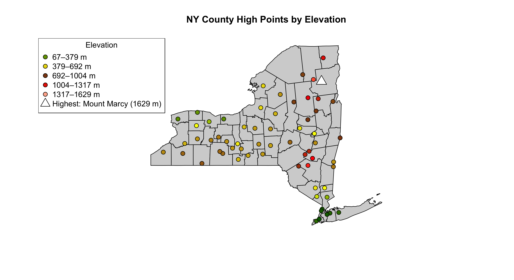
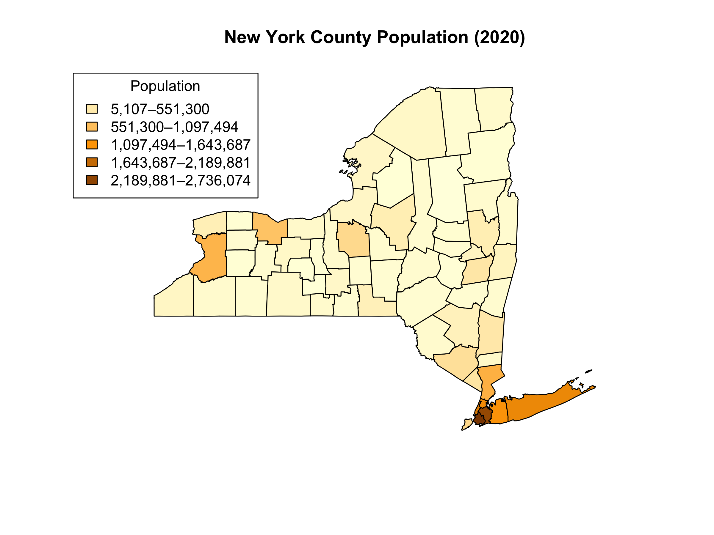
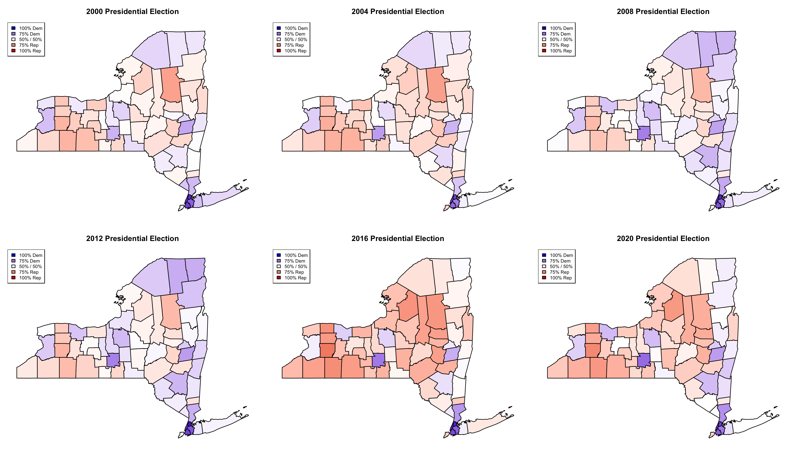

What follows are four spatial visualizations of New York State using thr 2024 U.S. Census County shapefile (cb_2024_us_county_500k), the NYS High Point Dataset (nyshighpoints.csv), the 2020 U.S. Decennial Census via tidycensus, and the Algara & Amlani County Presidential Returns Dataset (2000-2020):

- **Map 1**: New York Counties and Elevation High Points
- **Map 2**: New York County Population (2020)
- **Map 3**: New York County Population Density (2020)
- **Map 4**: New York Two-Party Presidential Vote Share (2000-2020)

## Map 1: New York Counties by Elevation
{fig-align="center" width="70%"}

+ **Highest High Point**: Mount Marcy (Essex County) at 5,344 feet (1,629 meters)
 
+ **Lowest High Point**: Todt Hill (Richmond County / Staten Island) at 410 feet (125 meters)

## Map 2: County Population (2020)
{fig-align="center" width="70%"}

+ **County with the Highest Population**: Kings County with a population of 2,736,074

+ **County with the Lowest Population**: Hamilton County with a population of 5,107

## Map 3: County Population Density (2020)
{fig-align="center" width="70%"}

+ **Most Population Dense County**: New York County, at about 74,781 people per square mile

+ **Least Population Dense County**: Hamilton County at about 3 people per square mile

## Map 4: Two Party Presidential Election Results (2000-2020)
{fig-align="center" width="70%"}

+ **Continuity**: New York exhibits a urban-rural partisan divide across all six elections. New York City boroughs, excluding Staten Island in most cycles, and major upstate urban centers, such as Erie(Buffalo), Monroe(Rochester), Onondaga(Syracuse), Tompkins(Ithaca), and Albany consistently vote Democratic. On the other hand, rural counties remain reliably Republican. 

+ **Change**: Between 2000 to 2012, Democrats gained ground across New York, peaking in 2008 and 2012 when Barack Obama won several upstate and suburban counties (including St. Lawrence, Jefferson, Clinton, and Oswego). Starting in 2016 and continuing into 2020, voting patterns flipped: rural and industrial upstate counties swung heavily Republican, while downstate suburbs (like Westchester, Rockland, and Nassau) and upstate cities became even more Democratic.

