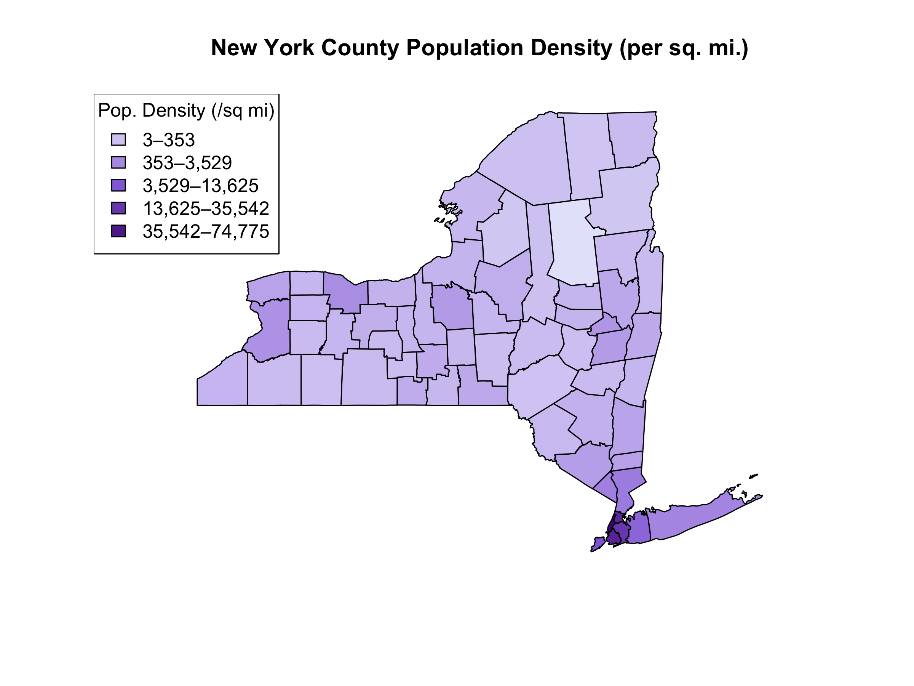

Include the map of New York counties and color-coded high points, with the highest point labeled. Which are the highest and lowest high points, and what are their elevations?
## Map 1
{fig-align="center" width="70%"}

Include the map of county population by county. What are the most and least populous counties, by name?
## Map 2
{fig-align="center" width="70%"}

Include the map of county population density. What are the most and least densely populated counties, by name?
## Map 3
{fig-align="center" width="70%"}

Include county maps of presidential elections in New York, by county. (I recommend doing this in a grid on a single page.) What do you notice about vote trends in New York over that time? What change and continuity has there been in partisan voting trends?
## Map 4
{fig-align="center" width="70%"}

